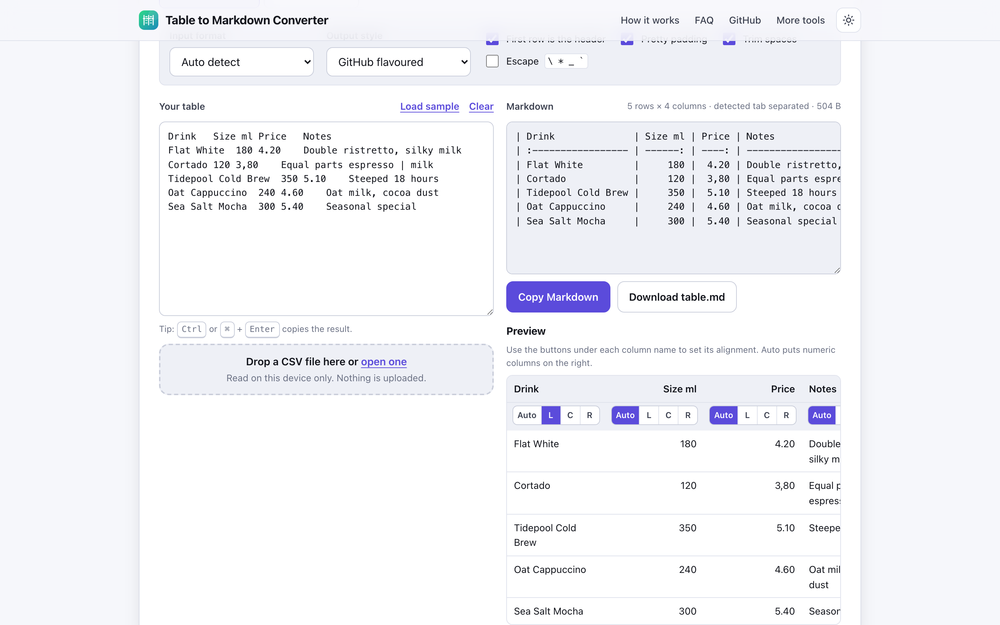
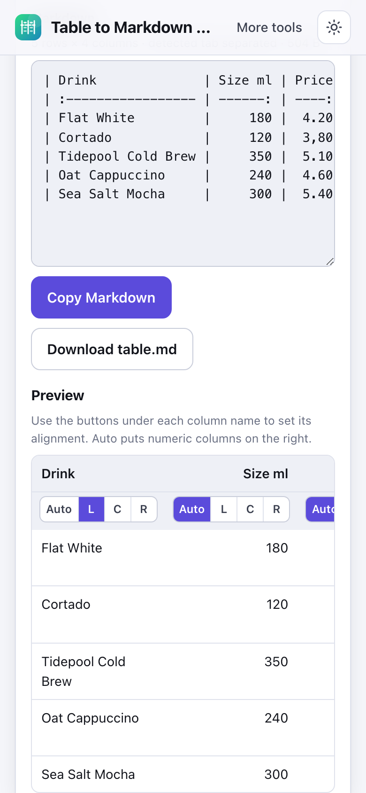

# Table to Markdown Converter

> Paste a table from Excel, Sheets or CSV and get a clean Markdown table in your browser, nothing sent anywhere.

**🌐 Use it now: [turhe123.github.io/table-to-markdown-local](https://turhe123.github.io/table-to-markdown-local/)** · free · open source · runs in your browser · works offline


## Why

Table to Markdown Converter is a free, open-source alternative to TablesGenerator and Table Convert (Excel to Markdown tools with ad-heavy pages, clunky editors, and pasted data processed on remote or third-party scripts). Here your files never leave the device, there is no account, no ads and no limits, it works offline, and it can be installed as an app.

## Screenshots

<p align="center"></p>

<p align="center"><em>Table to Markdown Converter in the browser, light theme</em></p>

<p align="center"></p>

<p align="center"><em>Table to Markdown Converter on a phone</em></p>

## Features

- Paste straight from Excel or Google Sheets (tab separated), or paste CSV, TSV, semicolon separated text, an HTML table, or a Markdown table.
- Auto-detects the input format, or pick it yourself from the Input format menu.
- Open a file or drop it on the page or the input box (`.csv`, `.tsv`, `.tab`, `.txt`, `.md`, `.markdown`, `.html`, `.htm`). One file at a time, up to 50 MB.
- Pasted HTML tables are read in a detached document (never inserted into the page); merged cells are repeated and line breaks in cells are kept.
- Header row toggle; empty header cells get a `Column N` placeholder.
- Per-column alignment (Auto, Left, Center, Right) using buttons under each column in the preview. Auto aligns numeric columns to the right.
- Pretty padding so the pipes line up in plain text (East Asian wide characters count as two columns; emoji and combining marks are measured by code point), or compact output without padding.
- GitHub flavoured output with outer pipes, or plain output without them.
- Pipe characters inside cells are escaped, and line breaks become `<br>` (GitHub style) or a space (plain style). Optional escaping of `\ * _` and backticks.
- Optional trimming of leading and trailing spaces; ragged rows are padded with empty cells; line endings are normalised.
- Reverse mode: paste a Markdown table and get CSV. Switching modes carries the current result over, so you can round-trip.
- Live preview table, built with `textContent` so pasted content can never inject markup. Shows the first 500 rows; a note appears above 5,000 rows.
- Copy button (Clipboard API with a fallback for older Safari), plus `Ctrl`/`⌘` + `Enter` to copy.
- Download as `table.md` (or `table.csv` in reverse mode).
- Clear message pointing at unbalanced quotes in CSV input.
- Works at 390 px wide, in light and dark themes, and with the keyboard.

**Input formats:** tab separated, CSV, semicolon separated, HTML table, Markdown table.
**Output formats:** Markdown table (GitHub flavoured or plain); CSV in reverse mode.
**Limits:** files up to 50 MB; the preview is capped at 500 rows (the output always contains every row).

## How to use

1. Copy cells from Excel or Google Sheets (or a table from a web page) and paste them into the input box, or drop a CSV file onto the page. Use **Load sample** to try it first.
2. Check the detected format and adjust the options: header row, padding, trimming, output style.
3. Set the alignment of any column with the buttons under its name in the preview.
4. Click **Copy Markdown** (or press `Ctrl`/`⌘` + `Enter`), or **Download table.md**.
5. Need the opposite direction? Switch to **Markdown → CSV** and paste a Markdown table.

## Privacy

- Nothing you paste or open is uploaded. All conversion happens in your browser.
- No cookies.
- Page views are counted anonymously with [GoatCounter](https://www.goatcounter.com/) (cookieless, open source). That is the only network request besides the page's own files.
- Offline use works through a service worker that caches the page's own files.

## Run it locally

```sh
git clone https://github.com/turhe123/table-to-markdown-local
cd table-to-markdown-local
python3 -m http.server 4173
```

Then open http://127.0.0.1:4173/. There is no build step.

## Tests

```sh
npm i -D @playwright/test && npx playwright install chromium
npx playwright test
```

## Third-party code

| Library | Version | License |
| --- | --- | --- |
| [papaparse](https://www.papaparse.com/) (`vendor/papaparse/`) | 5.5.3 | MIT |

## Built with AI

Table to Markdown Converter was written by [Claude Code](https://claude.com/claude-code) inside an automated pipeline, from a plain-English spec. No code or assets from any commercial product were used; it is a clean-room implementation of a feature set, not a copy.

What that means in practice:

- The full source is in this repo under the MIT license. Read it before you trust it with your files.
- Everything runs in your browser. It makes no network requests except an anonymous, cookieless page-view count (GoatCounter); your files never leave the device.
- The page is tested headless in Chromium (Playwright) before every release, but it has had less human review than hand-written software. Bug reports and pull requests are welcome.

## Support ❤️

If this saved you some time, you can support the project on [Ko-fi](https://ko-fi.com/leodavidai).

## More free web tools

Browse the rest of the collection at [turhe123.github.io/web-tools](https://turhe123.github.io/web-tools/).

## License

MIT © Or Davidai Bachar
